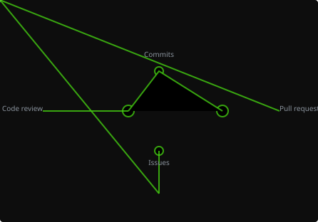

# Shahab Ahmed

  

## About

**Shahab Ahmed**

I build practical software. I contribute to open-source projects. I care about useful engineering, clean implementation, and reliability.

---

## Focus

I tinker with backend services and CLI tools, exploring Go and Rust when the problem demands it. I'm currently drawn to local-first software, data pipelines, and anything that reduces friction in daily development workflows.

---

## Contribution

<!---
  Minimalist custom contribution graphic: dark charcoal canvas with thin green
  vertical and horizontal lines intersecting at centre, small green-outlined
  circular nodes, and four category labels (Commits, Pull requests, Issues,
  Code review) positioned around the diagram. Percentages omitted — the graphic
  is decorative rather than data-driven.
--> 

  

---

## Selected work

| Project | Description |
|---|---|
| [zynex-ai](https://github.com/ShahabAhmed01/zynex-ai) | Autonomous AI research agent. Topic-in, cited report with charts and PDF/HTML export. Built with Python, FastAPI, and OpenRouter. |
| [OutreachKit](https://github.com/ShahabAhmed01/OutreachKit) | Open-source Instagram & Facebook DM automation tool. Local-first, MIT-licensed. Scrape reel commenters, send personalized bulk DMs with daily caps, multi-campaign management, and a modern glass-morphism web dashboard. |
| [opensource-contributions](https://github.com/ShahabAhmed01/opensource-contributions) | Curated record of open-source contributions: issues, pull requests, validation, and merge status. |

---

## Contact

- [Website](https://shahabcodes.dev)
- [LinkedIn](https://www.linkedin.com/in/shahabahmed01)
- [GitHub](https://github.com/ShahabAhmed01)

typed from Lahore, pk — kept minimal on purpose